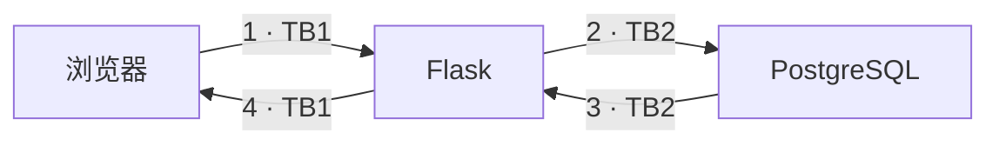
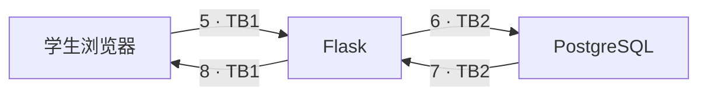
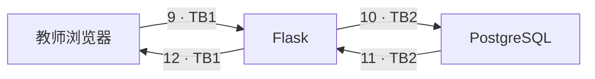
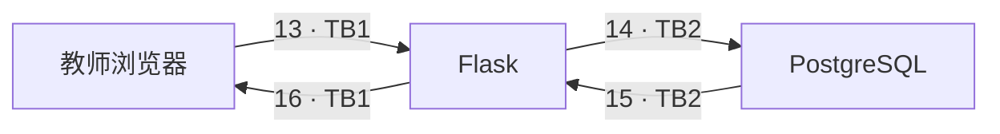
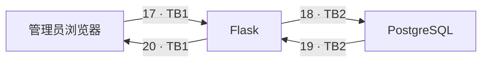
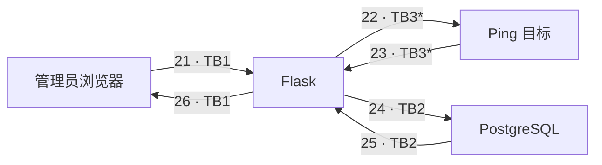
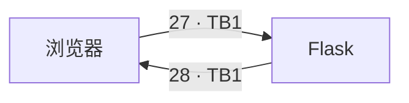

# NotesApp 编号数据流图

每条箭头的消息见 [Flow List](README.md#3-数据流图与-flow-list)。相同名称表示同一个组件。TB1 为浏览器/Flask；TB2 为 Flask/数据库；TB3 为外部 Ping 目标。三个角色复用登录和退出流程。

## 登录

## 学生查看成绩

## 教师查看与导出

## 教师新增与修改成绩

## 管理员管理用户

## 管理员 Ping

## 退出登录

部署补充：Web 还挂载 Docker socket 和宿主项目目录，这会削弱容器隔离。第二课业务图没有把尚未发生的 Docker API 调用画成实际数据流。登录、成绩写入和 Ping 的日志作为 Flask 节点内部副作用处理。
