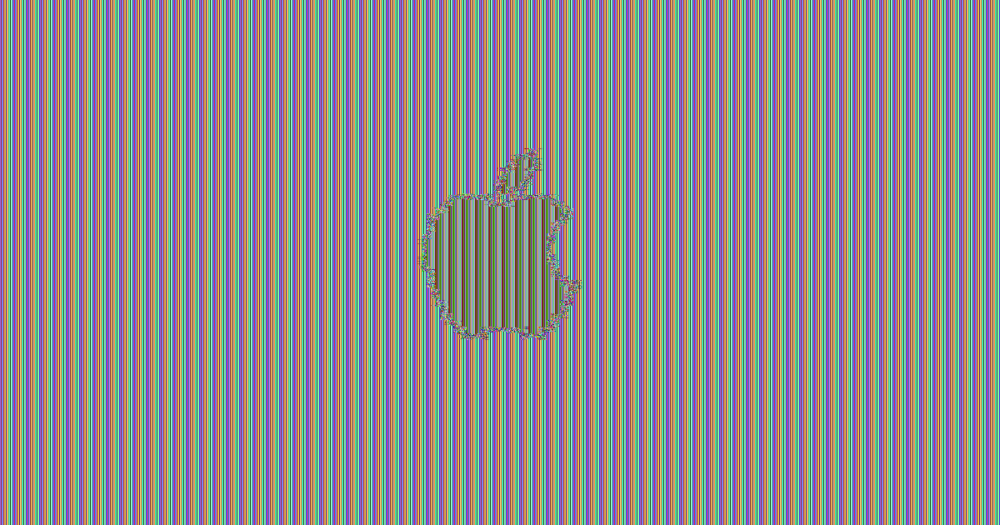
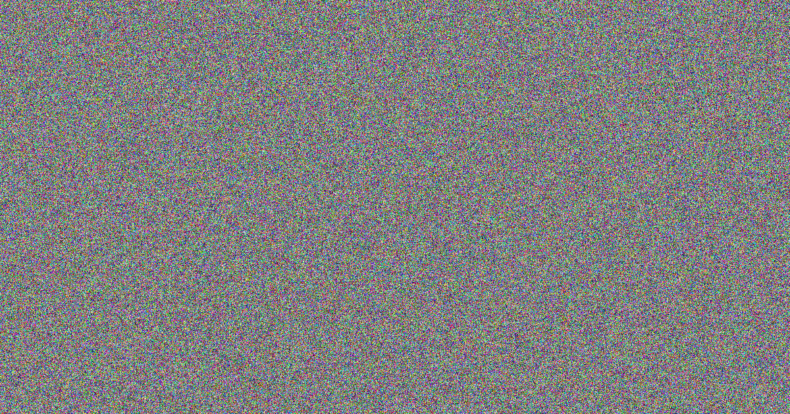

# 第三课对称加密课堂实验

已完成凯撒密码的频率分析破解，以及 AES-ECB 和 AES-GCM 的图片加密对比。代码、样例和实际运行结果均保存在本目录，方便课堂展示和重新运行。

依据：`Session 03 Symmetric Encryption.pdf` 第 30 页。课内实验为 45 分钟，独立或两人合作，工具为 Python、cryptography 和 Pillow。教师没有补充指定密文或图片；英文短句为自建样例，图片按用户要求使用苹果官网的 Apple Logo。NotesApp 加密属于课后作业，小组 Project 1 单独安排。

## 运行步骤

原实验在 Python 3.12.14、cryptography 50.0.1、Pillow 12.2.0 环境验证。本目录由课程工作区 `实验/Session03/` 的当前代码、素材和实际结果整理，代码及图片字节保留不变；原目录的虚拟环境、缓存和旧版过程文件不打包。首次运行先按下方命令建立环境，再在仓库根目录执行：

```sh
cd class3
python3 caesar.py
.venv/bin/python image_modes.py
.venv/bin/python -m unittest discover -s tests -v
```

凯撒代码只使用 Python 内置语法，直接在终端打印原文、密文、猜出的密钥和解密结果；不需要安装依赖。最后一条命令运行 7 项测试。

图片脚本从 `assets/apple.jpg` 读取素材，结果保存到本项目已有的 `results/images/` 目录。请在本实验目录运行；重新运行会更新两张加密效果图。

首次使用时，在 `class3/` 目录建立环境：

```sh
uv venv --python 3.12
uv pip install --python .venv/bin/python -r requirements.txt
```

## 实验一原理

输入使用大写英文。加密时，把每个字母在字母表中向前移 `key` 位；超过 Z 就从 A 继续。解密时向后移相同的位数。空格、标点和其他字符原样保留。

```text
HELLO，key = 3 → KHOOR
新位置 = (原位置 + key) % 26
```

凯撒密码会保留字母出现次数，所以可以先数密文中的字母。按照课件第 14 页的简单方法，假设最多的字母对应英文 E。例如最多的是 L，那么猜出的密钥是 `(11 - 4) % 26 = 7`。

这是一个猜测：原文中最多的字母如果不是 E，就可能猜错，短句尤其如此。

## 实验一步骤与结果

[caesar.py](caesar.py) 共 46 行，只有三个函数：

- `encrypt(text, key)`：逐字母移位加密。
- `decrypt(text, key)`：用负的密钥移位解密。
- `crack(text)`：用 26 个计数器找出最多的密文字母，假设它对应 E，返回猜出的密钥。

运行方式：

```sh
python3 caesar.py
```

程序末尾直接写了自建的短句和演示密钥，修改这两个变量即可换样例。破解函数只收到密文，没有收到演示密钥。

本次实际输出：

```text
Original: THE SECRET MESSAGE IS HERE. WE NEED TO KEEP THE MESSAGE SAFE.
Encrypted: AOL ZLJYLA TLZZHNL PZ OLYL. DL ULLK AV RLLW AOL TLZZHNL ZHML.
Guessed key: 7
Decrypted: THE SECRET MESSAGE IS HERE. WE NEED TO KEEP THE MESSAGE SAFE.
```

猜出的密钥为 7，解密结果与原文一致。[终端结果](results/caesar/output.txt)已保存。当前运行入口为简化后的 `caesar.py`。

## 实验二原理

ECB 对每个 16 字节块独立加密，相同明文块会产生相同密文块，所以图片的大块纯色区域仍然能显出轮廓。GCM 的结果呈现噪声，并带有认证标签。相关接口见 [ECB](https://cryptography.io/en/latest/hazmat/primitives/symmetric-encryption/#cryptography.hazmat.primitives.ciphers.modes.ECB) 和 [AESGCM](https://cryptography.io/en/latest/hazmat/primitives/aead/#cryptography.hazmat.primitives.ciphers.aead.AESGCM) 官方文档。

## 实验二步骤与结果

[image_modes.py](image_modes.py) 共 20 行，从上到下完成四步：

1. 读取苹果官网的 [Apple Logo 图片](assets/apple.jpg)，把 RGB 像素变成字节。
2. 生成 AES 密钥，执行 ECB 加密并保存效果图。
3. 按课件第 25 页生成 12 字节 nonce，执行 GCM 加密。
4. 保存 GCM 效果图，在下表并排观察两种结果。

运行方式：

```sh
.venv/bin/python image_modes.py
```

课件第 25 页只给了 GCM 示例；ECB 和 Pillow 图片读写接口是完成第 30 页实验所需的补充用法。当前代码保留这两项必要用法，去掉缩放、拼图和目录创建。

几行代码可以这样理解：

- `Image.open(...).convert("RGB")`：读取图片，统一使用红、绿、蓝三个颜色通道。
- `image.tobytes()`：把像素变成加密函数可以接收的字节。
- `AESGCM.generate_key(bit_length=256)`：课件原有的随机密钥生成方法，ECB 和 GCM 共用这把密钥。
- `Cipher(..., modes.ECB()).encryptor()`：准备一个 ECB 加密器；`update(data)` 加密像素，`finalize()` 结束本次加密。
- `AESGCM(key).encrypt(nonce, data, None)`：沿用课件的 GCM 代码，把示例文本 `b"Good work"` 换成图片字节。
- `Image.frombytes(...).save(...)`：把密文字节当成像素保存，方便观察。

原图为 1200 × 630，RGB 像素有 `1200 × 630 × 3 = 2268000` 字节，刚好是 16 的倍数，因此本例不需要缩放或补齐。换成其他尺寸的图片可能需要额外处理。

`gcm_data` 包含密文和最后 16 字节的认证标签。`gcm_data[:-16]` 表示去掉末尾 16 字节，只用密文画图；完整结果仍留在变量中，真正解密时需要保留认证标签。脚本只保存观察用的 PNG，密钥、nonce 和完整密文保存在本次运行的内存中。

| ECB 加密效果 | GCM 加密效果 |
| --- | --- |
|  |  |

实际效果：ECB 仍能看清 Apple Logo 的轮廓，GCM 呈现噪声。两张输出分别是 [ecb_pixels.png](results/images/ecb_pixels.png) 和 [gcm_pixels.png](results/images/gcm_pixels.png)。

## 图片来源

原始图片来自 [Apple Newsroom 官方图片文件](https://www.apple.com/newsroom/images/default/apple-logo-og.jpg?202608191822)，由[苹果官方新闻页面](https://www.apple.com/newsroom/2026/01/apple-reports-first-quarter-results/)的分享图片元数据引用。2026-10-08 下载保存为 `assets/apple.jpg`，保留原始 JPEG 字节；尺寸为 1200 × 630，大小为 17,959 字节。

SHA-256：`2172fd3dbe2adb1180222673a64c2ab28f984e443cc11133bf774a33044ce391`。实验只读取原图像素，原始文件保留不变。

## 验证结果

7 项测试通过：包括凯撒密码、图片输出、ECB 和 GCM 解密还原、GCM 对密文和认证标签改动的拒绝。验证代码单独放在 `tests/`，两份课堂程序分别为 `caesar.py` 和 `image_modes.py`。

当前两份程序都使用简化写法。测试会在临时目录重新生成图片，不覆盖本目录保存的实际结果。

## 课堂展示英文说明

> I encrypted a message with Caesar, then counted the letters in the ciphertext. I assumed that the most common letter represented E. This gave me a key of 7, and the decrypted message matched the original. This method can fail if E is not the most common letter in the original message.
>
> I encrypted an official Apple logo image with AES-ECB and AES-GCM. ECB still showed the logo because identical blocks produced identical encrypted blocks. GCM produced a noise-like image.
